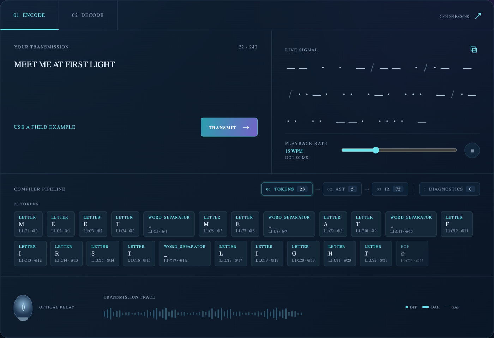
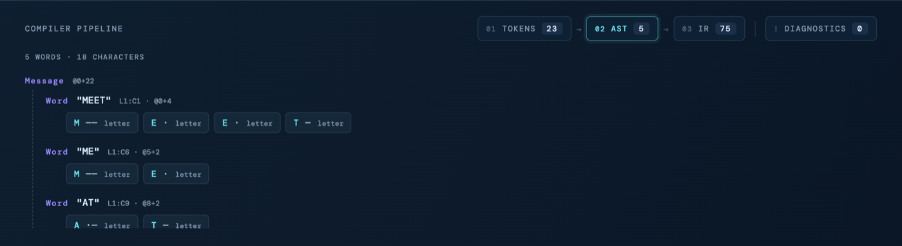
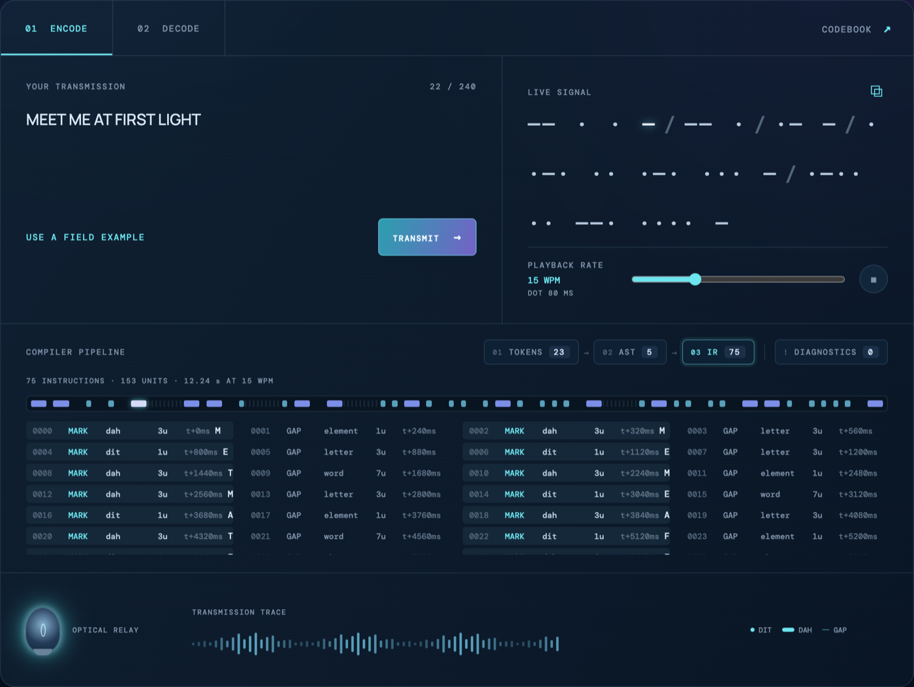
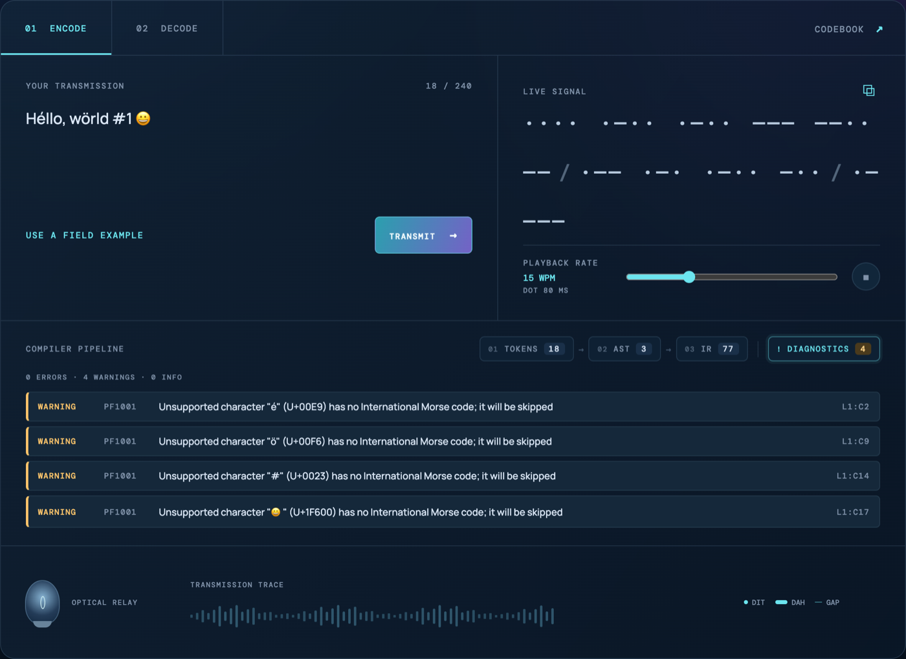
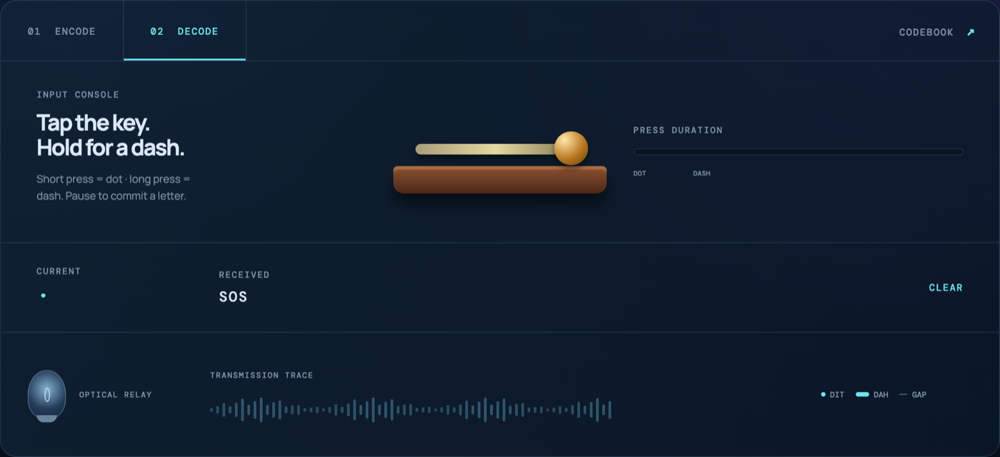
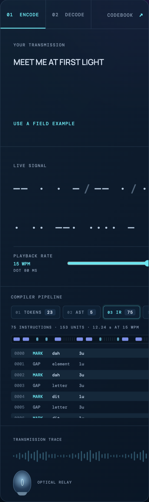

# Pulsefield — Morse Studio

[](https://github.com/prerak2612/morse-code-studio/actions/workflows/ci.yml)
[](LICENSE)

Pulsefield is a browser-native Morse code studio built as a small compiler. Text goes through four phases (lexing, parsing, IR lowering and code generation). The result plays back as text, audio and light with standard ITU timing. Every phase can be inspected live in the interface.

The app runs from static files and needs no runtime dependencies or build step.



## Features

- **Compiler pipeline:** a position-aware lexer, an AST parser with error recovery, a timed Morse IR and a code generator.
- **Correct timing:** a dot lasts `1200 / WPM` ms. Gaps are 1 unit inside a letter, 3 units between letters and 7 units between words.
- **Three output targets driven by the same IR:** highlighted text, a Web Audio tone with a click-free envelope, and the optical relay bulb.
- **Live inspection panels:** tokens, AST, IR (with a proportional timeline) and diagnostics, all updated as you type.
- **Diagnostics:** each has a stable code, a severity and a line/column position. Clicking one selects the offending text.
- **Decoder:** key Morse with the mouse, touch or spacebar. Letters and word spaces are committed automatically after a pause.
- **Accessibility:** works with the keyboard, uses ARIA tabs and live regions, and honours `prefers-reduced-motion`.

## Quick start

Requirements: Node.js 20 or newer (only for the dev server and tests) and a modern browser.

```bash
git clone https://github.com/prerak2612/morse-code-studio.git
cd morse-code-studio
npm install
npm start            # http://localhost:8080
```

You can also open `index.html` directly. All scripts are classic scripts, so `file://` works.

| Command | Purpose |
|---|---|
| `npm start` | Zero-dependency static server (`PORT` overrides 8080) |
| `npm test` | Run the test suite with the built-in `node:test` runner |
| `npm run test:watch` | Re-run the tests on every change |
| `npm run test:coverage` | Suite with V8 coverage |

## Compiler pipeline

```
 source ──► Lexer ──► tokens ──► Parser ──► AST ──► Lowering ──► IR ──► Scheduler ──► timeline ──► Transmitter
            lexer.js             parser.js          ir.js                timing.js                  ├─► text
                                     │                                                              ├─► audio
                                     └──────────────► diagnostics ◄──── lexer INVALID tokens        └─► light
```

| Phase | Module | Output |
|---|---|---|
| Lexing | [`src/compiler/lexer.js`](src/compiler/lexer.js) | A lossless token stream with offset, line and column. See [Lexical Analysis](docs/LEXICAL_ANALYSIS.md). |
| Parsing | [`src/compiler/parser.js`](src/compiler/parser.js) | `Message → Word → Character` AST, plus diagnostics for skipped input |
| Lowering | [`src/compiler/ir.js`](src/compiler/ir.js) | A flat list of `MARK` (dit 1u / dah 3u) and `GAP` (element 1u / letter 3u / word 7u) instructions |
| Text codegen | [`src/codegen/text.js`](src/codegen/text.js) | `... --- ...` with ` / ` between words, with each segment mapped back to its IR index |
| Scheduling | [`src/codegen/timing.js`](src/codegen/timing.js) | An absolute timeline for a given WPM (`dot = 1200 / WPM`) |
| Execution | [`src/codegen/transmitter.js`](src/codegen/transmitter.js), [`outputs.js`](src/codegen/outputs.js) | Drives audio, light and highlight outputs. Can be stopped and restarted at any point. |
| Decoding | [`src/decoder/decoder.js`](src/decoder/decoder.js) | Reverse lookup and the telegraph-key state machine |
| UI | [`src/ui/app.js`](src/ui/app.js), [`src/main.js`](src/main.js) | DOM wiring. The clock, audio and clipboard are injected. |

`compile(source)` in [`src/compiler/compiler.js`](src/compiler/compiler.js) runs the whole pipeline and returns `{ tokens, ast, ir, diagnostics, output }`.

### Timing

The scheduler uses the PARIS standard: one word (`PARIS` plus its 7-unit word gap) is exactly 50 units, so at *W* WPM a dot lasts `1200 / W` ms.

| Element | Units | At 20 WPM |
|---|---|---|
| Dit | 1 | 60 ms |
| Dah | 3 | 180 ms |
| Gap inside a letter | 1 | 60 ms |
| Gap between letters | 3 | 180 ms |
| Gap between words | 7 | 420 ms |

Audio is scheduled ahead of time on the `AudioContext` clock, so the tone stays sample-accurate even when the main thread is busy. Light and text highlights are driven by the same timeline.

### Diagnostics

| Code | Severity | Meaning | Effect |
|---|---|---|---|
| `PF1001` | warning | Character has no International Morse code (`#`, `é`, emoji, …) | Skipped |
| `PF1002` | warning | Control character | Skipped |
| `PF1003` | error | Malformed Unicode (lone surrogate) | Blocks transmission |
| `PF2001` | info | Nothing encodable in the message | Transmit is a no-op |

## Screenshots

| AST | IR during transmission |
|---|---|
|  |  |

| Diagnostics | Decoder |
|---|---|
|  |  |



## Demo procedure

A five-minute walkthrough that shows every compiler phase:

1. **Start:** run `npm start` and open `http://localhost:8080`.
2. **Lexing:** type `Hi @ 2`. **Tokens** shows 7 tokens, including `i → I` normalisation, `WORD_SEPARATOR` and `EOF`, each with `L:C` and offset.
3. **Parsing:** open **AST**. The `Message` holds three words, `"HI"`, `"@"` and `"2"`, and each character is labelled letter, punctuation or digit with its Morse code.
4. **IR:** open **IR**. The summary reads `… INSTRUCTIONS · … UNITS · … s AT 15 WPM`. The timeline shows 1u dits, 3u dahs and the 7u hatched word gaps.
5. **Timing:** set the rate to **20 WPM**. The label shows `DOT 60 MS` and the IR start times rescale. Type `PARIS` and the summary shows 43 units; with the 7-unit word gap that makes 50 units, so 2.58 s plus 0.42 s equals 3 s, which is one word every 3 s, or 20 WPM.
6. **Code generation:** press **Transmit**. The tone, the bulb, the Morse text and the active IR row all move in step. Press **■** or **Esc** to stop at once.
7. **Diagnostics:** type `Héllo #1 😀`. **Diagnostics** lists three `PF1001` warnings with positions. Click one to select that character in the editor. Transmit still works and skips them.
8. **Decoding:** switch to **Decode** and tap the spacebar for `··· ——— ···`, pausing between letters. **Received** shows `SOS`.
9. **Quality:** run `npm test` to see the suite pass, and check the CI badge on the repository.

## Testing

The suite uses the built-in `node:test` runner and has no dependencies. Any `tests/*.test.js` file is picked up automatically.

GitHub Actions ([`.github/workflows/ci.yml`](.github/workflows/ci.yml)) runs a syntax check and the suite on Node 20 and 22 for every push to `main` and every pull request. On Node 22 it also reports coverage.

## Deployment

Pulsefield is a static site. Deploy the repository root, excluding `node_modules/`, `tests/` and `scripts/`.

**GitHub Pages**

1. Go to *Settings → Pages*.
2. Set *Source: Deploy from a branch*, *Branch: `main`*, folder `/ (root)`.
3. The site is published at `https://<owner>.github.io/morse-code-studio/`. All asset paths are relative, so no base-path configuration is needed.

**Netlify / Vercel / Cloudflare Pages**

Leave the build command empty and set the publish directory to `.`.

**Any web server**

Copy `index.html`, `style.css` and `src/` to the web root. Audio starts only after the user presses Transmit, as browser autoplay policies require. Clipboard copy needs HTTPS or `localhost`.

## Project structure

```
index.html            Markup and script loading order
style.css             Visual system and responsive layout
src/compiler/         lexer, parser, diagnostics, IR, compile()
src/codegen/          text emitter, timing, transmitter, audio/light outputs
src/decoder/          reverse lookup and telegraph-key state machine
src/ui/app.js         UI controller (clock, audio and clipboard injected)
src/main.js           Browser bootstrap
scripts/serve.js      Local static server
tests/                node:test suites
docs/                 Phase documentation and screenshots
```

See [ARCHITECTURE.md](ARCHITECTURE.md) for design decisions.

## Team

| Member | Area | Branch |
|---|---|---|
| Prerak ([@prerak2612](https://github.com/prerak2612)) | Studio foundation, UI and repository | `main` |
| Soniya Malviya | Lexical analysis | `feature/lexer-soniya` |
| Abhishek ([@A-cpu-rg](https://github.com/A-cpu-rg)) | Code generation, integration and quality | `feature/codegen-tests-abhishek` |

## Changelog: `feature/codegen-tests-abhishek`

This branch covers code generation, integration and quality. It builds on the lexer from `feature/lexer-soniya` and leaves that work unchanged.

**Compiler and code generation**
- Added a parser (`src/compiler/parser.js`) that builds a `Message → Word → Character` AST from the lexer's tokens and recovers from invalid characters.
- Added coded diagnostics (`src/compiler/diagnostics.js`): `PF1001`–`PF1003` and `PF2001`, each with a severity and a line/column position.
- Added IR lowering (`src/compiler/ir.js`), which emits `MARK` and `GAP` instructions with ITU unit lengths.
- Added `compile(source)` (`src/compiler/compiler.js`), which runs the full pipeline in one call.
- Added a text emitter, a scheduler and a transmitter (`src/codegen/`) that execute the IR across text, audio and light.

**Playback and timing**
- Playback now consumes the IR instead of raw characters.
- Timing is correct: `dotDuration = 1200 / WPM`, with 1-unit element, 3-unit letter and 7-unit word gaps. The old player used about 12 units between words.
- The speed control shows real WPM (5–40) and the dot length. The old label said "5 WPM" while playing at about 9.4 WPM.
- Audio is scheduled on the `AudioContext` clock with short ramps, so playback has no drift and no clicks.
- Stop, Esc, editing the message or switching tabs all halt playback at once and reset the bulb, the audio and the highlights.

**Interface**
- Added the Compiler Pipeline panel with Tokens, AST, IR and Diagnostics tabs.
- The IR tab shows a proportional timeline and an instruction list. Both highlight live during transmission.
- Clicking a diagnostic selects the offending characters in the editor. Malformed input blocks transmission; unsupported characters are skipped with a warning.
- Replaced `script.js` with `src/ui/app.js` (the clock, audio and clipboard are injected) and `src/main.js` (browser bootstrap).
- Moved the decoder into `src/decoder/decoder.js` as a clock-driven state machine.
- Fixed the Decode panel layout, where the result row sat beside the key instead of below it.
- Letters are now visibly separated in the live signal, and the status indicator shows when a transmission is running.

**Quality and tooling**
- Added the npm scripts `start`, `test`, `test:watch` and `test:coverage`, and a zero-dependency dev server (`scripts/serve.js`).
- Added a GitHub Actions workflow that runs a syntax check and the tests on Node 20 and 22, with coverage.
- Updated the README and ARCHITECTURE docs and added screenshots, the MIT license and `.gitignore`.

## License

[MIT](LICENSE)
